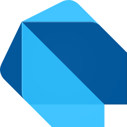
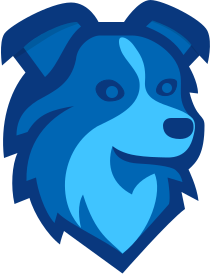
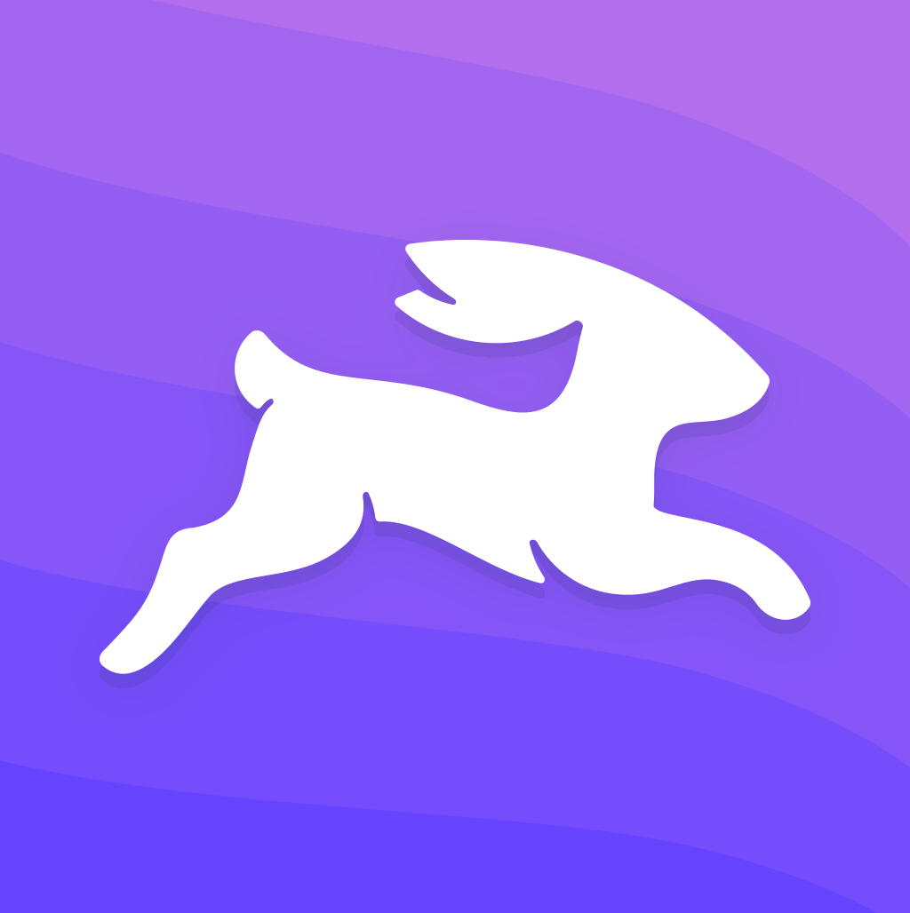
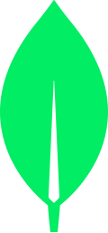
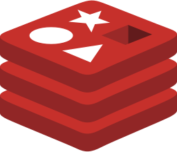
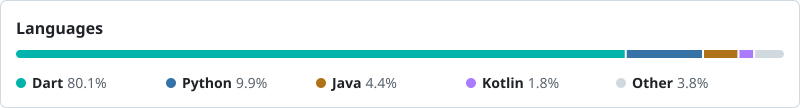

<!-- HERO:START -->
<picture>
  <source media="(prefers-color-scheme: dark)" srcset="assets/travis-dark.svg">
  
</picture>
<!-- HERO:END -->

## Tech stack

<!-- STACK:START -->
<table>
<tr><td>Language</td><td> <a href="https://dart.dev">Dart</a></td></tr>
<tr><td>Front-end</td><td> <a href="https://flutter.dev">Flutter</a>&nbsp;&nbsp;&nbsp; <a href="https://jaspr.site">Jaspr</a></td></tr>
<tr><td>Back-end</td><td> <a href="https://dart-frog.dev">Dart Frog</a>&nbsp;&nbsp;&nbsp; <a href="https://directus.com">Directus</a>&nbsp;&nbsp;&nbsp; <a href="https://www.postgresql.org">PostgreSQL</a>&nbsp;&nbsp;&nbsp; <a href="https://www.mongodb.com">MongoDB</a>&nbsp;&nbsp;&nbsp; <a href="https://redis.io">Redis</a></td></tr>
<tr><td>DevOps</td><td> <a href="https://www.docker.com">Docker</a>&nbsp;&nbsp;&nbsp; <a href="https://github.com/features/actions">GitHub Actions</a>&nbsp;&nbsp;&nbsp;<a href="https://railway.com"><picture><source media="(prefers-color-scheme: dark)" srcset="assets/icons/railway-dark.svg"></picture></a> <a href="https://railway.com">Railway</a>&nbsp;&nbsp;&nbsp; <a href="https://www.cloudflare.com">Cloudflare</a></td></tr>
<tr><td>Analytics</td><td> <a href="https://posthog.com">PostHog</a>&nbsp;&nbsp;&nbsp;<a href="https://umami.is"><picture><source media="(prefers-color-scheme: dark)" srcset="assets/icons/umami-dark.svg"></picture></a> <a href="https://umami.is">Umami</a>&nbsp;&nbsp;&nbsp; <a href="https://newrelic.com">New Relic</a></td></tr>
<tr><td>Design</td><td> <a href="https://www.figma.com">Figma</a>&nbsp;&nbsp;&nbsp; <a href="https://www.apple.com/keynote/">Keynote</a></td></tr>
</table>
<!-- STACK:END -->

## This year

<picture>
  <source media="(prefers-color-scheme: dark)" srcset="https://raw.githubusercontent.com/nontravis/nontravis/output/analytics-languages-dark.svg">
  
</picture>

<!-- COMMITS:START -->

<a href="https://github.com/nontravis?tab=repositories"><picture><source media="(prefers-color-scheme: dark)" srcset="https://raw.githubusercontent.com/nontravis/nontravis/output/analytics-commits-header-dark.svg"></picture></a> 
<a href="https://github.com/nontravis/stratum_flutter_ui"><picture><source media="(prefers-color-scheme: dark)" srcset="https://raw.githubusercontent.com/nontravis/nontravis/output/analytics-commits-row-1-dark.svg"></picture></a> 
<a href="https://github.com/nontravis/specstone"><picture><source media="(prefers-color-scheme: dark)" srcset="https://raw.githubusercontent.com/nontravis/nontravis/output/analytics-commits-row-2-dark.svg"></picture></a> 
<a href="https://github.com/Nextzy/dart-falconx"><picture><source media="(prefers-color-scheme: dark)" srcset="https://raw.githubusercontent.com/nontravis/nontravis/output/analytics-commits-row-3-dark.svg"></picture></a> 
<a href="https://github.com/Nextzy/flutter-falconx"><picture><source media="(prefers-color-scheme: dark)" srcset="https://raw.githubusercontent.com/nontravis/nontravis/output/analytics-commits-row-4-dark.svg"></picture></a> 
<a href="https://github.com/Nextzy/jaspr-falconx"><picture><source media="(prefers-color-scheme: dark)" srcset="https://raw.githubusercontent.com/nontravis/nontravis/output/analytics-commits-row-5-dark.svg"></picture></a>

<!-- COMMITS:END -->

<picture>
  <source media="(prefers-color-scheme: dark)" srcset="https://raw.githubusercontent.com/nontravis/nontravis/output/snake-dark.svg">
  
</picture>

